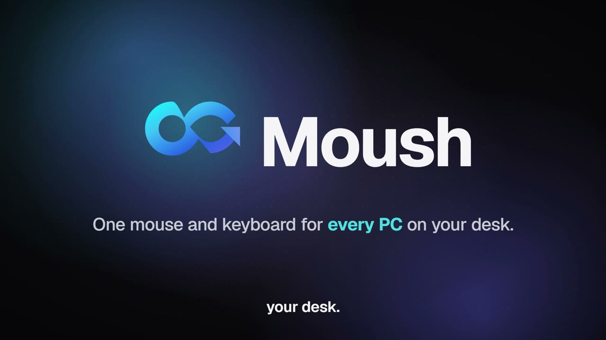

# Moush

[](https://github.com/rakibul-islam-hasib/moush/actions/workflows/ci.yml)
[](LICENSE)


[](CONTRIBUTING.md)
[](https://rakibul-islam-hasib.github.io/moush/)

Use one mouse and keyboard across several Windows computers on the same network. Move the
cursor off the edge of your desktop's monitors and it continues on your laptop; the
keyboard follows the cursor. Move back and you are on the desktop again.

**Status:** Moush is 0.x software and supports Windows 10 and 11 only. The wire protocol,
settings format and UI may change before 1.0. macOS and Linux are not supported.

```
[ Laptop ] [ Monitor 1 ] [ Monitor 2 ]      ← arranged in the layout editor, not hard-coded
   client        host           host
```

- **One app, two roles.** The *host* is the computer the mouse and keyboard are plugged
  into; *clients* are controlled by it. Pick the role on first launch, change it later in
  Settings.
- **Seamless switching.** Crossing between the host's own monitors stays a normal Windows
  transition; only edges that touch another computer in the layout hand over input.
- **Multi-monitor and mixed DPI.** Monitor sizes, positions and scaling are detected on
  both sides; a 150 % laptop appears next to 100 % monitors at its real-world size.
- **Low latency.** Event-driven capture and injection, a single TCP connection with
  `TCP_NODELAY`, no polling on the input path. ~50 µs end-to-end processing overhead
  measured on loopback (see [docs/PERFORMANCE.md](docs/PERFORMANCE.md)).
- **Secure by default.** Every connection is encrypted and mutually authenticated (Noise
  XX). New devices must be approved on both computers by comparing a 6-digit code.
- **No stuck keys.** Every key is released on the computer that received its press —
  when the cursor moves, the connection drops, the session locks or the app exits.
- **Keyboard that follows you.** Alt+Tab and Win shortcuts act on the computer you are
  working on (or stay on the host, if you prefer); Ctrl+Alt+Shift+Arrow jumps between
  computers. See [docs/KEYBOARD.md](docs/KEYBOARD.md).
- **Shared clipboard.** Text, rich text and images copied on one computer paste on the
  others; sensitive clips (password managers) are skipped; optional in-memory history.
- **File transfer.** Drag files onto the window: streamed, encrypted, integrity-checked,
  resumable, with approval on the receiving side. Plus one-click sharing of text and links.
- **Configurable per device.** Every feature can be switched off globally or per paired
  device from the UI.
- **Windows 11 look.** Fluent-inspired UI with Mica, light, dark and high-contrast themes,
  reduced-motion support; lives in the notification area.
- **Small.** ~2 MB installer, ~7 MB app; input path unaffected by transfers (see
  [docs/PERFORMANCE.md](docs/PERFORMANCE.md)).

## See it in 100 seconds

[](website/assets/video/moush-film.mp4)

The film and its poster are in [`website/assets/video`](website/assets/video). Media credits
are in [THIRD_PARTY_NOTICES.md](THIRD_PARTY_NOTICES.md).

## Quick start

1. Download the latest `Moush_x.y.z_x64-setup.exe` from
   [Releases](https://github.com/rakibul-islam-hasib/moush/releases/latest) and install it on
   both computers. The installer is per-user and needs no admin rights. Both computers must
   be on the same network.
2. On the computer with the mouse and keyboard choose **Host**. When Windows asks whether
   Moush may communicate on networks, allow it on **private** networks. (Or use
   *Diagnostics → Add firewall rule*.)
3. On the laptop choose **Client**. The host appears under *Devices*; click it. If it
   does not appear (discovery blocked), type the host's IP address shown on the host's
   *Diagnostics* page.
4. A pairing dialog appears on **both** computers. Check that the 6-digit codes match and
   click **Allow** on both. Paired devices reconnect automatically from then on.
5. On the host open **Devices → Screen layout**. Your monitors are shown as Windows arranges them; drag the
   laptop so one of its edges touches the side of the monitor it sits next to on your
   desk (the touching segment turns blue), then **Save**. **Test** jumps the cursor to the
   laptop.

Move the cursor through the highlighted edge: it appears on the laptop and the keyboard
types there. Move back to return.

### Shortcuts (on the host keyboard)

| Shortcut | Effect |
| --- | --- |
| **Ctrl + Alt + Esc** | Bring the cursor back to the host immediately |
| **Ctrl + Alt + Shift + Arrow** | Jump to the neighbouring computer in that direction |
| **Ctrl + Alt + Shift + Home** | Jump back to the host |
| **Scroll Lock** | Lock the cursor to the computer it is on (toggle; can be disabled) |

The tray icon menu also has *Bring cursor back to this computer*.

## What Windows does not allow

- **Ctrl+Alt+Del, the lock screen and UAC prompts** run on the secure desktop; no
  application can capture or inject input there. When the host locks, the cursor returns
  to the host automatically.
- **Win+L** always locks the host (Windows handles it before any application).
- **Elevated (administrator) windows on the client** reject injected input from a
  non-elevated program (UIPI). Run Moush as administrator on the client if you need
  to control such windows. The same applies on the host: while an elevated window has
  focus there, the hooks do not see input.

## Building from source

Requirements: Windows 10/11, Rust 1.85+ (MSVC toolchain), Node.js 22+ (Vite 8 also accepts
20.19+), WebView2 runtime (preinstalled on Windows 11).

```powershell
npm install
npx tauri build                     # release app + NSIS installer in target\release\bundle\nsis
npx tauri dev                       # development build with hot reload
cargo test --workspace              # unit + loopback integration tests
cargo build --release -p moush-cli  # headless tool moush-cli.exe (see below)
```

### Headless tool

`target\release\moush-cli.exe` runs the same engine without the UI — useful for testing on
two machines, benchmarking and troubleshooting:

```
moush-cli monitors                       list monitors as Moush sees them
moush-cli discover                       find hosts on the LAN
moush-cli host [--port N]                run as host (pairing prompts in the console)
moush-cli client <ip|host-id> [--dry-run]  run as client; --dry-run logs instead of injecting
moush-cli bench [--events N]             full network-path latency benchmark on loopback
moush-cli selftest                       verify input capture/injection APIs on this machine
moush-cli identity                       print this device's id and public key
```

`scripts\e2e-local.ps1` runs a live end-to-end test on one machine (real GUI host with
real hooks, dry-run client, synthetic input; see the script header).

## Repository layout

| Path | Contents |
| --- | --- |
| `crates/moush-core` | OS-independent core: wire protocol, Noise channel, layout geometry, input router state machine, host/client networking, discovery, pairing and trust. Fully unit-tested. |
| `crates/moush-engine` | Windows layer: low-level hooks, `SendInput`, monitor enumeration, DPAPI, autostart, firewall; host and client orchestration. |
| `crates/moush-cli` | `moush-cli` headless tool. |
| `src-tauri` | Desktop app: Tauri commands, snapshots/events, tray, window. |
| `src` | React + TypeScript UI. `src/api/types.ts` is the UI ↔ backend contract. |
| `docs` | [Install & usage guide](docs/GUIDE.md), [keyboard](docs/KEYBOARD.md), [architecture](docs/ARCHITECTURE.md), [security](docs/SECURITY.md), [performance](docs/PERFORMANCE.md), [troubleshooting](docs/TROUBLESHOOTING.md). |

Settings, the device identity (DPAPI-encrypted), paired devices and the layout are stored
in `%APPDATA%\Moush`; logs in `%LOCALAPPDATA%\Moush\logs`.

## Tech stack

| Layer | Built with |
| --- | --- |
| Core engine | Rust 2024 edition: wire protocol, layout geometry, input router, discovery, pairing |
| Transport | Noise XX (`snow`): X25519, ChaCha20-Poly1305, BLAKE2s over a single TCP connection |
| Windows layer | Win32 low-level hooks, `SendInput`, DPAPI, via `windows` / `windows-sys` |
| Desktop app | Tauri 2 (WebView2), tray icon, single-instance |
| UI | React 19, TypeScript, Vite, Geist |

## Contributing

Issues and pull requests are welcome, from typo fixes to new features. See
[CONTRIBUTING.md](CONTRIBUTING.md) for setup, where things live and what a PR needs, and
[CODE_OF_CONDUCT.md](CODE_OF_CONDUCT.md) for the community rules.

## Security

Please report vulnerabilities privately; see [SECURITY.md](SECURITY.md). The threat model
and the rules every feature module follows are in [docs/SECURITY.md](docs/SECURITY.md).

## License

[MIT](LICENSE). Fork it, change it, ship it. Third-party software, fonts and media are
credited in [THIRD_PARTY_NOTICES.md](THIRD_PARTY_NOTICES.md).
